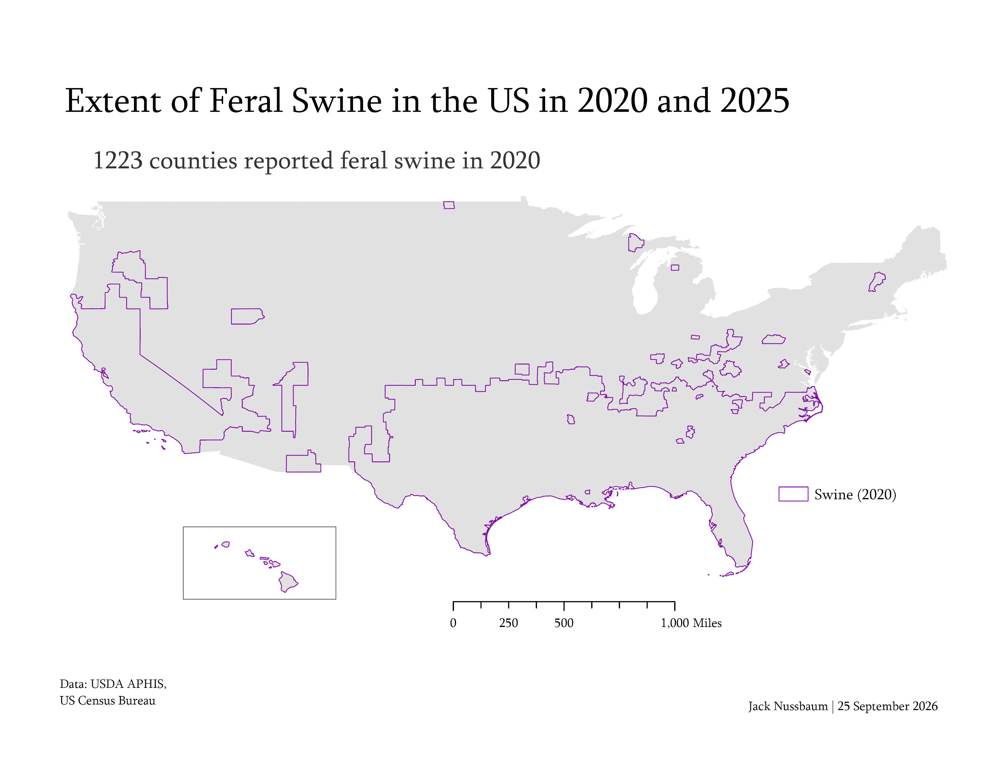
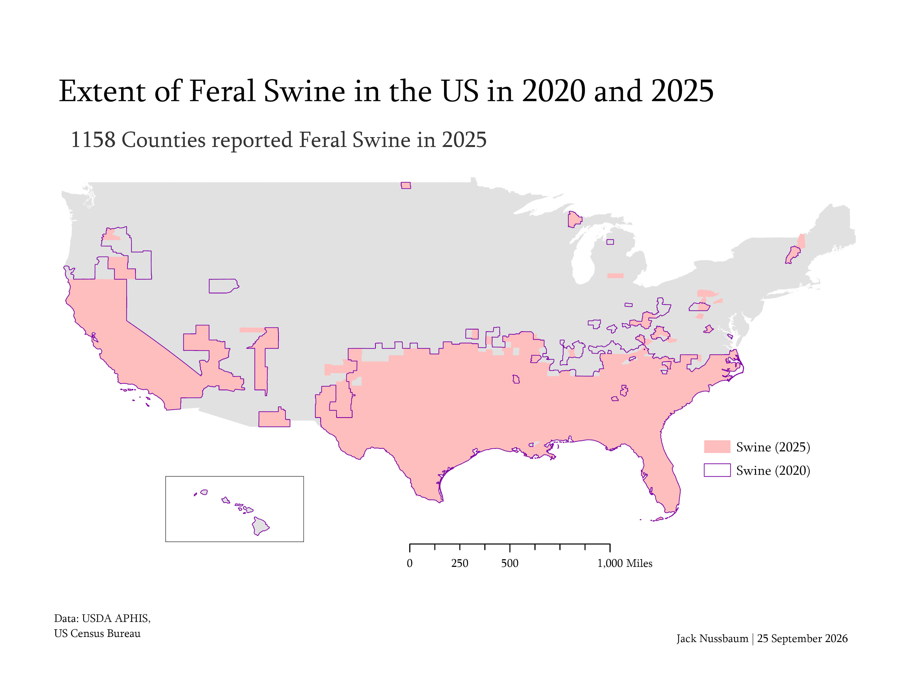
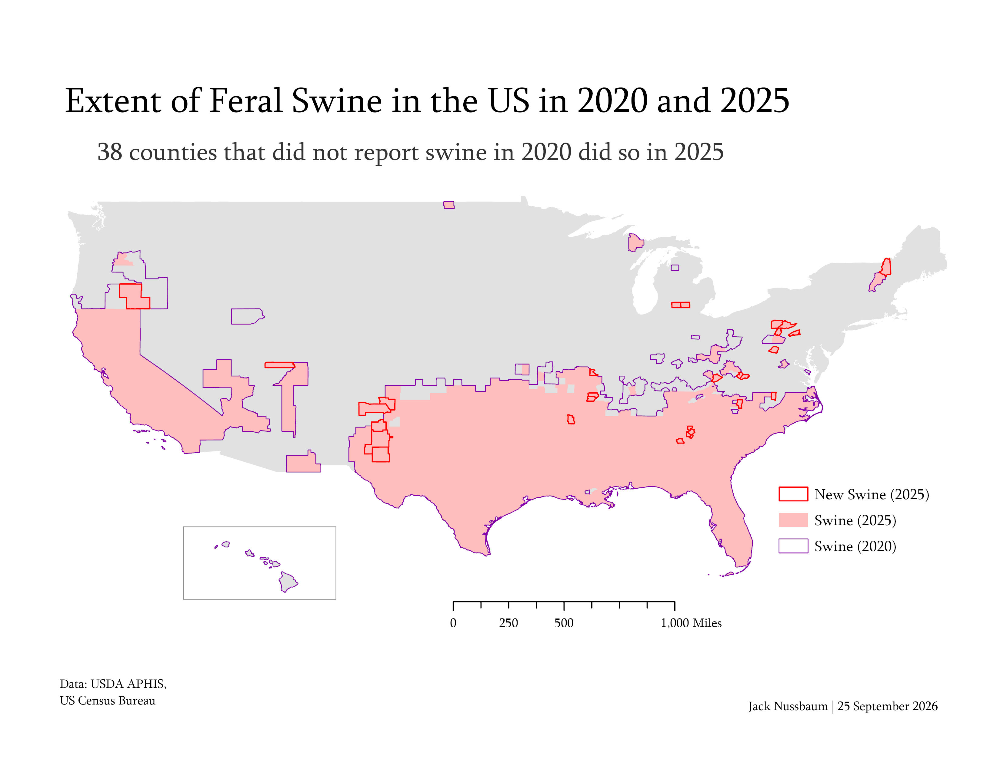
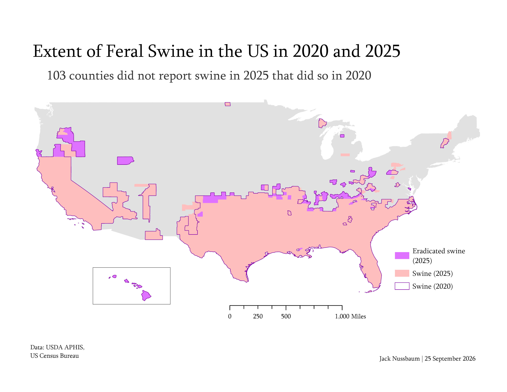

# Cleaning and EDA

```{r}
#| messsage: FALSE
#| warning: FALSE

library(tidyverse)
clean_counties <- function(year) {
  read_csv(str_c("../data/raw/swine-counties/counties_", year, ".csv")) |> 
    select(county_ID = FIPS,
           county = NAME,
           state = STATE_NAME) |> 
    mutate(swine = TRUE, year = year) |> 
    unique()
}

combined_counties <- list_rbind(map(2020:2025, clean_counties)) |> 
  pivot_wider(names_from = year, values_from = swine,
              names_prefix = "swine_") |> 
  mutate(across(where(is.logical), ~if_else(is.na(.x), FALSE, .x)))

write_csv(combined_counties, "../data/clean/combined_counties.csv")

```

This is the data that I loaded into ArcGIS, then joined by county_ID with the US county shapefiles I downloaded from the US Census Bureau. The visuals below helped with the process and communication.

```{r}
counties <- read_csv("../data/clean/combined_counties.csv")

counties |> 
  pivot_longer(cols = starts_with("swine_"), names_to = "year", values_to = "swine") |> 
  mutate(year = as.factor(str_remove(year, "swine_"))) |> 
  filter(swine) |> 
  count(year)

counties |> 
  filter(swine_2020, !swine_2025) |>
  count(state) |> 
  filter(n > 1) |> 
  mutate(state = fct_reorder(as.factor(state), n)) |> 
  ggplot(aes(x = n, y = state)) +
  geom_col(fill = "#DF73FF") +
  labs(title = "Eradicated Counties", x = "# of counties", y = "State") +
  theme_classic()

counties |> 
  filter(!swine_2020, swine_2025) |>
  count(state) |> 
  filter(n > 1, !is.na(state)) |> 
  mutate(state = fct_reorder(as.factor(state), n)) |> 
  ggplot(aes(x = n, y = state)) +
  geom_col(fill = "#FF0000") +
  labs(title = "New Counties", x = "# of counties", y = "State") +
  theme_classic()

```

# Visualization

This series of 4 maps was used for FP2.

::: {layout-ncol=2}
{width=50%, fig-alt="A map depicting counties that have reported feral swine in 2020."}

{width=50%, fig-alt="A map depicting counties that have reported feral swine in 2020 and 2025."}

{width=50%, fig-alt="A map depicting counties that have reported feral swine in 2020 and 2025. Counties with feral swine in 2025 but not 2020 are highlighted."}

{width=50%, fig-alt="A map depicting counties that have reported feral swine in 2020 and 2025. Counties with feral swine in 2020 but not 2025 are highlighted."}
:::

# Narrative

This map series shows the extent and progression of feral swine in the US in 2020 and 2025. In the first frame, we can see the counties that reported feral swine to the USDA in 2020. This range is outlined in purple and sets the context for the rest of the data. We hope to be able to identify patterns among the data that might help predict future feral swine habitat. Geographically, these counties are well condensed, located in the southern United States and California. This suggests that climate plays a role, but that the animal has yet to migrate much further north. 

The layer showing the 2025 range shows little, but potentially meaningful change. These changes are highlighted in the third and fourth maps, highlighting new counties with and without swine, respectively. A majority of the differences are on the northern border of their range, in Kentucky, Missouri and Oklahoma. While Hawai'i shows that their swine have been eradicated, recent sources seem to explain that feral swine are still an issue there.